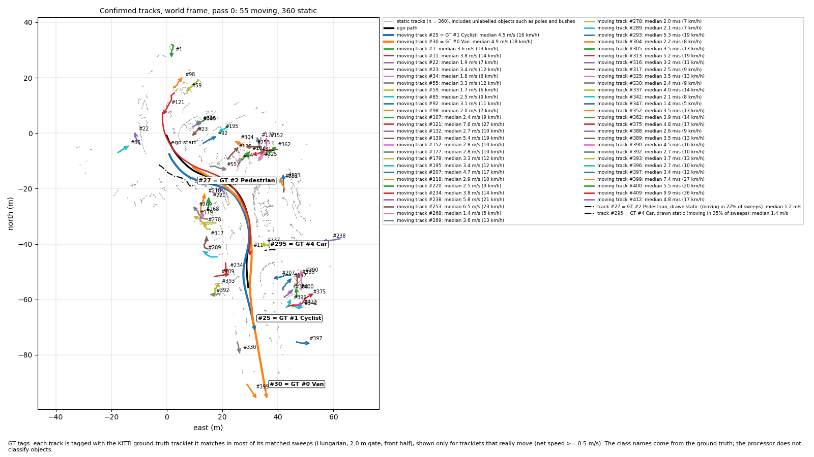
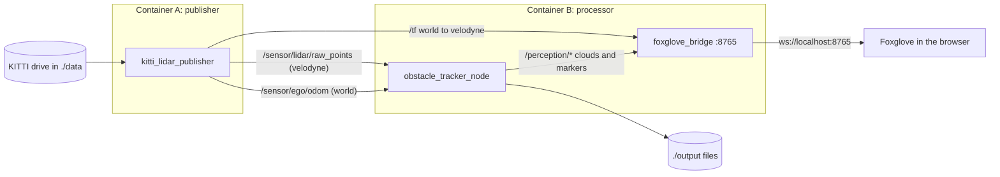
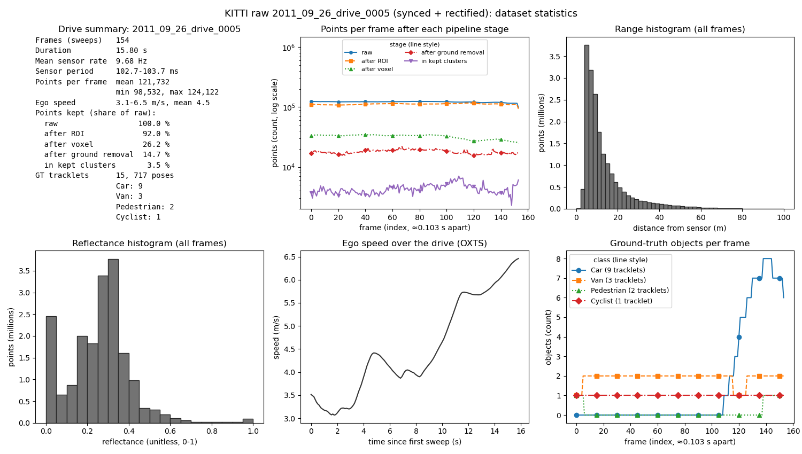
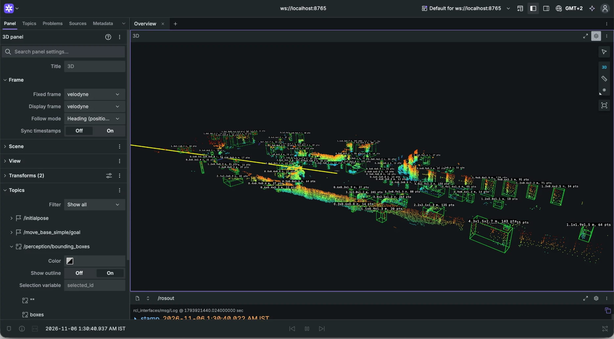

# LiDAR Obstacle Tracking

BGRacing Autonomous home assignment. A two-container ROS 2 Jazzy pipeline replays a KITTI raw LiDAR drive as a live sensor, detects obstacles, and tracks them in a world frame. Velocities are corrected for the car's own motion, so parked cars read about 0 m/s, and they are scored against KITTI's ground-truth tracklets. Every number below is regenerated by one command (see [How to run](#how-to-run)); the design decisions and rejected alternatives are in [docs/design.md](docs/design.md).



- **Detect:** ROI crop, voxel downsampling, seeded RANSAC ground removal with local ground tiles, 2D DBSCAN clustering and an oriented size filter. Car+Van recall 0.908.
- **Track:** Kalman filter plus Hungarian association in the `world` frame, with the ego pose from the GPS/IMU. Parked cars read a median 0.38 m/s; the lead van and the cyclist read within 0.22 and 0.24 m/s of the ground truth.
- **Prove it:** one command scores the tracks and runs the ablation. Without ego compensation the parked-car velocity error is 8.19 times larger.

## Architecture

Two containers on compose's default bridge network exchange ROS 2 topics. Every message carries the dataset timestamp of its sweep, and nothing uses wall-clock time for velocities.



| Topic | Type | Frame | Published by | Contents |
|---|---|---|---|---|
| `/sensor/lidar/raw_points` | `PointCloud2` | `velodyne` | publisher | x, y, z, intensity of one sweep; sensor-data QoS (best effort) |
| `/sensor/ego/odom` | `Odometry` | `world` | publisher | pose of the `velodyne` frame in `world`, plus the car's twist in `velodyne` axes |
| `/tf` | `TFMessage` | | publisher | `world → velodyne`, one per sweep |
| `/perception/filtered_points` | `PointCloud2` | `velodyne` | processor | points after ROI, downsampling and ground removal |
| `/perception/bounding_boxes` | `MarkerArray` | `world` | processor | one wireframe box per confirmed track, colored by state (the label topic carries the state as text) |
| `/perception/obstacle_vectors` | `MarkerArray` | `world` | processor | one arrow per moving track, length = speed × 0.5 s |
| `/perception/track_labels` | `MarkerArray` | `world` | processor | `#ID state N km/h` per confirmed track |
| `/perception/ego_vehicle` | `MarkerArray` | `velodyne` | processor | display only: the ego car as a translucent box, the LiDAR origin and a forward arrow (see Limitations) |

Two frames: `velodyne` (the sensor frame; clouds are published in it) and `world` (ENU axes, x east, y north, z up, origin at the first GPS/IMU position; boxes, arrows and labels are published in it). The same ROS-free code (`core/` and `processor/`) runs live and in the offline runner, which is where all reported numbers come from. One live-versus-offline check proves the live node produces the same tracks.

## Dataset

KITTI raw drive `2011_09_26_drive_0005`, "synced + rectified": a city drive with moving and parked cars. The pipeline uses the Velodyne HDL-64 sweeps, the OXTS GPS/IMU poses, the IMU → Velodyne calibration and the tracklet ground truth.



| Property | Value |
|---|---|
| Sweeps | 154 over 15.80 s |
| Sensor rate | 9.68 Hz mean (period 102.7–103.7 ms), not 10 Hz |
| Points per sweep | mean 121,732; min 98,532; max 124,122 (float32 x, y, z, reflectance) |
| Range | 83 % of points within 20 m of the sensor, 96 % within 40 m, none beyond 82 m |
| Ego speed (OXTS) | 3.1–6.5 m/s, mean 4.5 m/s |
| Points kept by each stage | 92.0 % after the ROI, 26.2 % after voxel downsampling, 12.5 % after ground removal, 3.8 % in the kept clusters (means 112,002 / 31,938 / 15,232 / 4,565 points per sweep) |
| Ground truth | 15 tracklets (9 Car, 3 Van, 2 Pedestrian, 1 Cyclist), 717 boxes, all in front of the car |

The numbers come from [`docs/samples/dataset_stats.json`](docs/samples/dataset_stats.json). Regenerate them (no publisher needed) into `output/`:

```bash
docker compose run --rm --no-deps processor python3 /app/scripts/dataset_stats.py
```

Two runs produce byte-identical `dataset_stats.json` files, and the JSON matches `docs/samples/dataset_stats.json` on arm64 and on GitHub's x86_64 runner. The PNG is regenerated with it but not compared byte for byte.

**Time and poses.** Every message carries the sweep's stamp from `velodyne_points/timestamps.txt`, read as UTC. Poses come from OXTS via a Mercator projection, the same convention as pykitti, with `T_world_velo = T_world_imu · inverse(T_velo_imu)`.

## Pipeline

Each sweep goes through the same ROS-free code in the live node and in the offline runner. All parameters are in [`config/tracker.yaml`](config/tracker.yaml), read by both.

### Detection (`processor/perception.py`, `velodyne` frame)

1. **Region of interest:** x ∈ [−40, 40] m, y ∈ [−20, 20] m, z ∈ [−3, 2] m, minus the box around the ego car (|x| < 2.5 m, |y| < 1.5 m).
2. **Voxel downsampling:** one point per 0.15 m voxel, placed at the voxel's grid center, so the result does not depend on point order.
3. **Ground removal:** RANSAC plane fit (100 iterations, 0.2 m inlier distance), seeded per frame from a fixed seed and the sweep's stamp. The best plane is removed only if it is near-horizontal (|normal z| > 0.9, about 26° of tilt or less); otherwise the frame is marked `no_plane` and nothing is removed.
   Then the ground is refined per 10 × 10 m tile: a plane is fitted to each tile's voxels within 0.6 m of the global plane (trimmed twice to 0.15 m) and voxels within 0.2 m of it are removed too. One plane can't follow 80 m of road, and the band of ground it leaves 0.2–0.4 m above itself used to join cars to walls and bushes in the 2D clustering. A tile with fewer than 30 candidates, or a plane steeper than the rule above, keeps the global result.
4. **Clustering:** DBSCAN on (x, y), eps 0.6 m, at least 8 points. Two dimensions are faster and avoid splitting an object vertically.
5. **Size filter:** a cluster stays if it has at least 10 voxels, an oriented length ≤ 7 m and width ≤ 3 m (the minimum-area rectangle of its footprint), and a height between 0.3 and 3 m. The orientation matters: the car turns about 75° during the drive, so an axis-aligned width limit would reject 37–46 % of the vans in the ground truth even with perfect segmentation.
6. **Detection:** the axis-aligned box of each kept cluster (center, extents dx/dy/dz, voxel count). Boxes are not rotated.



The detection stage on its own, live in Foxglove (display frame `velodyne`): the filtered cloud and one wireframe box per detection, each labeled with its size and point count.

### Tracking (`processor/tracking.py`, `world` frame)

1. **World frame:** each detection center is moved into `world` with the ego pose that carries the same dataset timestamp, so parked objects keep the same position while the car drives.
2. **Prediction:** a constant-velocity Kalman filter per track, state (x, y, vx, vy). Δt comes from the dataset timestamps, never from wall time. Process noise 1.0 (m/s²)², measurement noise 0.5 m. Both were fixed before any tracking code ran and have not been tuned.
3. **Association:** Hungarian assignment on the distance between predicted and detected centers, gated at 2.0 m.
4. **Lifecycle:** a track is confirmed after 3 hits and deleted after 5 consecutive misses. A missing sweep counts as a miss, so a processing stall never resets anything. Only the dataset loop (timestamps jump back) resets the tracks, and IDs restart at 1 for each pass.
5. **Motion state:** a track is `moving` only if it is *confidently* faster than 0.7 m/s: speed − 2σ > 0.7 m/s, where σ is the filter's own speed uncertainty. With the plain rule (speed > 0.7 m/s), 197 of 417 tracks read as moving: mostly short-lived poles, bushes and wall pieces whose box center slides as the car drives past. The cost: σ settles at about 0.31 m/s, so after a few frames the effective threshold is about 1.3 m/s and a walking pedestrian is labelled `static` (its label still shows its speed).

Velocities come from the filter state, not from differences of box centers.

### Why these values

| Parameter | Value | Why |
|---|---|---|
| `voxel_size` | 0.15 m | cuts about 120k points to about 32k; keeps the whole frame under the 100 ms sensor period |
| `ransac_iters`, `ransac_dist` | 100, 0.2 m | enough three-point samples to find the road plane; seeded, so runs repeat |
| `dbscan_eps`, `dbscan_min_samples` | 0.6 m, 8 | chosen before any detection result and not swept (a sweep is a next step); two boxes closer than 0.6 m merge, as a unit test documents |
| Size limits | 7 × 3 × (0.3–3) m | a van fits; walls and buildings don't |
| `gate_m` | 2.0 m | the same gate scores detections against the ground truth |
| `confirm_hits`, `max_misses` | 3, 5 | a track is drawn after 3 sightings and survives 5 missed sweeps |
| `q_accel`, `r_pos` | 1.0, 0.5 m | fixed before any tracking code ran; not tuned |
| `moving_speed`, `moving_sigma` | 0.7 m/s, 2 | the confident motion state above |

No parameter was tuned against the reported results.

## Results

All numbers come from the offline runner over all 154 sweeps. The committed copies are in [`docs/samples/`](docs/samples/); two runs give byte-identical files (verified on arm64 and on GitHub's x86_64 runner).

### Detection

Scored against the KITTI tracklets in the front half of the region of interest (where ground truth exists), one-to-one Hungarian matching on 2D box centers with a 2.0 m gate. Source: [`docs/samples/detection_recall.json`](docs/samples/detection_recall.json).

| Class | Matched / ground-truth boxes | Recall | Tracklets |
|---|---|---|---|
| **Car + Van (the gated number)** | **472 / 520** | **0.908** | 12 |
| Car | 234 / 248 | 0.944 | 9 |
| Van | 238 / 272 | 0.875 | 3 |
| Pedestrian (small sample) | 6 / 22 | 0.273 | 2 |
| Cyclist (small sample) | 153 / 154 | 0.994 | 1 |

- The mean distance between matched centers is 0.54 m (90th percentile 1.39 m). Boxes are axis-aligned and built from the points the sensor sees, so a car seen from one side can have its box center offset from the true center (up to 1.9 m even for a perfect segmentation of the ground-truth boxes).
- The weakest tracklet is parked van #3, matched in 76 of 107 frames (0.710). The local ground tiles helped it only a little; its misses are still clusters merged into something larger than a van, and I have not diagnosed what it merges with. Pedestrians are mostly missed (6 of 22 boxes, two tracklets); the cause has not been diagnosed.
- On average 32.0 detections per sweep in that region match no ground-truth box (maximum 54). This is not a false-positive rate: the tracklets label only a few object types in front of the car, so unlabeled objects count as unmatched.
- Time per sweep for the detection stages (the sweep's file read excluded), on an Apple M5 Pro in Docker (linux/arm64): 95th percentile 49.7–50.4 ms over three runs (mean about 45 ms), against a 75 ms bar and the 100 ms live period. Pinned to a single core the 95th percentile was 64 ms. Live, with the publisher and bridge sharing the CPU, one run measured about 48 ms (the whole callback about 53 ms) and skipped no sweep (678 of 678). A typical live run loses a couple of sweeps (2 of 475 in another run), with the whole callback at 63 ms at the 95th percentile. Timing varies by machine and is not part of the committed samples.
- The recall gate in `./scripts/verify.sh` is 0.8 and the measured value is 0.908 (56 box-frames of margin).

### Tracking

Tracks are matched to the KITTI tracklets per sweep in the front half of the region of interest (Hungarian, 2D centers, 2.0 m gate) and scored per tracklet. A track's first 5 frames after confirmation are left out. Ground-truth speed is the difference of the tracklet's world positions over ±5 sweeps (1 s); over ±1 sweep, label jitter alone makes parked cars read 0.2–0.45 m/s. Source: [`docs/samples/tracking_speeds.json`](docs/samples/tracking_speeds.json) and, without ego compensation, [`docs/samples/tracking_speeds_no_ego.json`](docs/samples/tracking_speeds_no_ego.json).

**Parked objects** (the 10 tracklets that move less than 0.5 m/s in the ground truth), median filtered speed in m/s:

| Tracklet | Class | Frames scored | With ego compensation | Labelled moving | Without (ablation) |
|---|---|---|---|---|---|
| #3 | Van | 88 | 0.25 | 0 % | 4.68 |
| #5 | Car | 34 | 0.50 | 9 % | 5.41 |
| #6 | Car | 28 | 0.09 | 0 % | 5.70 |
| #7 | Car | 33 | 0.22 | 0 % | 6.50 |
| #8 | Van | 22 | 0.57 | 0 % | 4.98 |
| #9 | Car | 34 | 0.11 | 0 % | 6.41 |
| #10 | Car | 28 | 0.57 | 7 % | 5.81 |
| #11 | Car | 16 | 0.54 | 0 % | 5.16 |
| #13 | Car | 9 | 0.66 | 0 % | 5.41 |
| #14 | Car | 19 | 0.16 | 0 % | 6.26 |
| **Median of the medians** | | | **0.38** (bar 0.5) | | |

Every parked tracklet reads under 0.7 m/s (the bar; the worst is #13 at 0.66, scored on only 9 frames). Without ego compensation the same cars read 4.7–6.5 m/s: the car's own motion.

**Moving objects** (median |filtered speed − ground-truth speed| per sweep; both accelerate during the drive):

| Tracklet | Class | Frames scored | Ground-truth speed (median) | Error (median, 90th pct.) | Labelled moving | Without ego compensation |
|---|---|---|---|---|---|---|
| #0 | Van | 103 | 4.77 m/s | 0.22, 1.00 m/s | 100 % | 1.87 m/s |
| #1 | Cyclist (small sample) | 147 | 4.62 m/s | 0.24, 0.47 m/s | 100 % | 3.72 m/s |

The bar is 0.5 m/s per object. `./scripts/verify.sh` gates both tables and checks that they fail without ego compensation.

**The report image** (`obstacle_tracking_report.png`, at the top): the ego path in black, moving tracks as solid lines with an ID and a velocity arrow (0.5 s ahead), static tracks thin, dashed and grey under one legend entry. A track is drawn as moving if the tracker labelled it `moving` in at least half of its sweeps. To make the real moving objects easy to find, the offline report tags every track matched to a ground-truth tracklet that moves (net speed ≥ 0.5 m/s): `#30 = GT #0 Van`, `#25 = GT #1 Cyclist`, `#27 = GT #2 Pedestrian` and `#295 = GT #4 Car`. **These class names come from the ground truth, as the footnote on the image says: the processor does not classify objects.** The live report has no tags.

**Live.** The live node gives byte-for-byte the same tracks as the offline tracker fed the same sweeps: checked over 4 passes (34,718 track rows, 0 mismatched), including passes with dropped sweeps, and every marker array starts with `DELETEALL`. On the dev machine the whole live callback, file writes included, took 63 ms at the 95th percentile, against the 100 ms sweep period; the tracking step itself takes under 2 ms.

### Evaluation

One command, with no publisher and no Foxglove, runs the offline pipeline twice (with and without ego compensation), scores both runs against the KITTI tracklets and writes `output/evaluation.md` (about 16 s on the dev machine). The committed copy is [`docs/samples/evaluation.md`](docs/samples/evaluation.md); the tables below are quoted from it. The file has six parts, each with a short "how to read this" note: a summary, what the pipeline produced, accuracy against the KITTI labels, physical consistency of the tracks the labels do not cover, the ablation, and the method.

**The main result: ego compensation.** This is the only number with a pass/fail bar, fixed before the first run. Static-object velocity RMSE (matched parked-car frames after the warm-up) is **0.653 m/s** with ego compensation and **5.348 m/s** without it: a ratio of **8.19**, against a bar of at least 3. Without the ego pose, 100 % of parked-car frames are labelled `moving` (277 of 277) instead of 1.6 % (5 of 311).

**Accuracy on the labelled objects** (no bar by design; GT box-frames in the front half of the region):

| Class | GT box-frames | Recall | Center error (m) |
|---|---|---|---|
| Car | 248 | 0.972 | 0.493 |
| Van | 272 | 0.853 | 0.787 |
| Cyclist (small sample) | 154 | 0.987 | 0.365 |
| Pedestrian (small sample) | 22 | 0.182 | 0.076 |
| **Overall** | 696 | 0.904 | 0.568 |

Car+Van recall is 0.910 (473 of 520 box-frames; the detection-only recall above is 0.908). Parked objects are labelled `static` in 0.984 of their frames (306 of 311); moving objects are labelled `moving` in 0.981 (253 of 258). There are 6 ID switches, all on parked cars (#3, #6, #10, #13). The per-tracklet table is in the sample.

**Most tracks have no label, and that is expected.** Of the 238 tracks with a frame in the evaluation region, 18 match a KITTI tracklet and 220 never do. Only 0.112 of the in-region track-frames are explained by a label (629 of 5,624), which is a lower bound on how many tracks are real objects, not an error rate. Many of the unlabelled tracks are probably poles, signs, trunks, bushes or walls: obstacles by the processor's definition (non-ground points within size limits) that the tracklets do not contain. Nothing here classifies them, but they can still be checked by physics. Once ego motion is removed, a fixed object must stay still, as a labelled parked car does:

| Tracks (at least 10 frames after the warm-up) | Scored (excluded as too short) | Median speed (m/s) | Median position spread (m) | Same, without ego compensation |
|---|---|---|---|---|
| Unlabelled | 127 (93) | 0.358 | 1.006 | 5.464 m/s, 7.689 m |
| Parked-car reference | 12 (2) | 0.413 | 0.599 | 5.487 m/s |

The unlabelled tracks have a similar median speed to the parked cars (0.358 against 0.413 m/s) but a larger position spread (1.006 against 0.599 m), and the two rows are not directly comparable, because the box center of a large object drifts more than that of a small one. This shows consistency, not correctness: a still track could equally be a wall segment or leftover ground, and the processor classifies nothing.

**False-moving rate.** Of the in-region track-frames that match no label, 0.086 (338 of 3,925) are labelled `moving` after the warm-up (0.978 without ego compensation). This counts every in-region track-frame that matches no tracklet, including unmatched frames of tracks that match one in other frames (for example when the lead van is briefly missed). It is the baseline that any fix for tracks wrongly labelled `moving` has to beat; the cause fixes are future work.

## How to run

### Prerequisites

- Docker with Compose v2 (Docker Desktop on macOS or Windows, Docker Engine on Linux). The two images take about 1.8 GB and 1.3 GB of disk; the drive is a 646 MB download that unpacks to about 290 MB in `./data`.
- `curl` and `unzip` on the host (the download script checks and tells you how to install them).
- Port 8765 free on the machine that runs Docker.
- For the live view: Chrome, Edge or Firefox and a free Foxglove account (or the Foxglove desktop app, which needs no account).

No Python, ROS or pip packages are needed on the host. The images are built from `ros:jazzy-ros-base` (Ubuntu 24.04, Python 3.12, pinned by digest) with the dependencies from apt.

### Commands

```bash
./scripts/download_kitti.sh                     # fetch the drive into ./data
docker compose up --build                       # run the pipeline (publisher + processor)
```

Stop it with `Ctrl+C` or `docker compose down`: the processor then writes its final files, including the report image.

```bash
docker compose run --rm --no-deps processor python3 /app/scripts/dataset_stats.py   # dataset statistics → output/
docker compose run --rm --no-deps processor python3 /app/scripts/run_offline.py      # detections, tracks, recall → output/offline/
docker compose run --rm --no-deps processor python3 /app/scripts/evaluate.py         # evaluation.md, both runs → output/
./scripts/verify.sh                                                                  # build, smoke import, all tests
```

The offline commands use `--no-deps`, so they don't start the publisher. `run_offline.py --set ego_compensation=false` runs the ablation by itself (results in `output/offline/no_ego/`).

### Expected outputs

| File in `output/` | Written by | What it is |
|---|---|---|
| `tracks.csv` | `docker compose up` (periodically and on stop) | every confirmed track state per frame, world frame: `pass, frame, stamp_ns, track_id, x, y, vx, vy, speed, state, l, w, h` |
| `detections.csv`, `frames.csv` | `docker compose up` | per-frame detection rows and stage point counts |
| `metrics.json` | `docker compose up` | frames processed and dropped, timing, track counts, seed and parameters (timing varies between runs) |
| `obstacle_tracking_report.png` | `docker compose up`, on stop only | top-down map of the tracks |
| `dataset_stats.json`, `dataset_stats.png` | `dataset_stats.py` | the dataset statistics above |
| `evaluation.md` | `evaluate.py` | the six-part evaluation; identical to [`docs/samples/evaluation.md`](docs/samples/evaluation.md) |
| `offline/` | `run_offline.py` | detections, tracks, `detection_recall.json`, `tracking_speeds.json` and the report image of the offline run |

To check your run against the committed results:

```bash
diff output/evaluation.md docs/samples/evaluation.md && echo "evaluation.md matches the sample"
```

The files in `output/` are readable and deletable by the host user. `./scripts/verify.sh` does this comparison for `evaluation.md` and the three JSON samples; it needs the drive in `./data`, and the real-data tests fail (they never skip) without it. A GitHub Actions workflow ([`.github/workflows/verify.yml`](.github/workflows/verify.yml)) runs the whole reviewer flow on an `ubuntu-24.04` (x86_64) runner: download, build, `verify.sh`, `evaluate.py` and the diff above, a live run and stop, and deleting `output/` as a normal user.

### Live view in Foxglove

1. Run `docker compose up --build` and wait until the processor log shows `foxglove_bridge` listening on port 8765.
2. Open <https://app.foxglove.dev> in Chrome, Edge or Firefox and sign in (a free account is required).
3. Choose Open connection → Foxglove WebSocket → `ws://localhost:8765`.
4. Import the layout: Layout menu → Import from file → [`viz/foxglove_layout.json`](viz/foxglove_layout.json). It shows the raw and filtered clouds, the boxes, arrows and labels, the ego car and a plot of the ego speed, with the display frame set to `world`. The ego car then drives through a still scene, and the parked cars stay put.

The bridge listens on `127.0.0.1` only, because `foxglove_bridge` has no authentication. Open Foxglove on the machine that runs Docker. The layout hides the transform axes and links: Foxglove draws them at its own clock time, not at the dataset's, so they don't follow the car.

### Troubleshooting

| Symptom | Cause and fix |
|---|---|
| The download fails | KITTI may need a login or the mirror may be down. The script prints the three files to download by hand from the KITTI raw-data page and where to put them. |
| `docker compose up` stops with an error naming the download script | `./data` is empty or incomplete. Run `./scripts/download_kitti.sh`. |
| Foxglove can't connect | Use Chrome, Edge or Firefox. Safari, and Brave with Shields on, can block a secure page from opening `ws://localhost`. Check `docker compose ps` shows `127.0.0.1:8765->8765`. Foxglove must run on the same machine as Docker. The Foxglove desktop app connects to the same address and needs no account. |
| The 3D panel is empty | Set the display frame to `world` (or `velodyne` for the raw clouds), and check the topics are switched on in the panel's sidebar. Re-import the layout if you changed it. |
| `ros2 topic list` shows no topics from the other container | Both services use `ROS_DOMAIN_ID=42` on compose's default bridge network. Start both with the same `docker compose up`. Host networking is not used. |
| Port 8765 is already in use | Stop the other program, or change the left side of `127.0.0.1:8765:8765` in `docker-compose.yml`. |
| `verify.sh` fails on the byte comparison of a sample | Compare with `diff`. The samples are verified on arm64 and on GitHub's x86_64 runner; a different CPU can in principle give a last-digit difference that is not a code defect. Please tell me what you see. |
| `output/` files can't be deleted | The processor image sets `umask 000`, so files are 0666 and folders 0777 and any host user can delete them. If you have old root-owned files from a build without it, delete them once with `sudo`. |
| Frames are dropped in the live run | About 2 % of sweeps can be lost on the bridge network; the count is in `metrics.json`. The reported numbers come from the offline runner, which never drops. |

## Limitations and next steps

**Limitations**
- Tracks carry no class. Most of the roughly 74 confirmed tracks per sweep are unlabelled static objects (poles, bushes, wall pieces); the evaluation shows they are physically consistent, not that they are correct.
- Pedestrians are mostly missed by detection (recall 0.27 on two tracklets) and walking pedestrians are labelled `static` by design. Both causes are undiagnosed or accepted, not fixed.
- Some clutter tracks drift enough to be labelled `moving`: the false-moving rate is 0.086. The van's speed error reaches 1.0 m/s at the 90th percentile, at 30–44 m where it is seen from behind and partly.
- Boxes are axis-aligned in the sensor frame, so `l, w, h` in `tracks.csv` change as the car turns.
- Ground truth exists only in front of the car, so every score covers the front half.
- The live node loses about 2 % of sweeps; reported numbers come from the offline runner.
- The sensor runs at 9.68 Hz while the publisher's timer ticks at 10 Hz; velocities use the stamps, so this does not matter for them.
- The ego car in Foxglove (`/perception/ego_vehicle`) is for orientation only: its size and position relative to the LiDAR are approximate. The cloud has no returns on the body to measure it from.
- Byte-identical results are verified on arm64 and on GitHub's x86_64 runner, not on every CPU. The apt packages in the images are not pinned, so a rebuild months from now may differ.
- Foxglove's web app needs a free account.

**Next steps** (not done)
- A DBSCAN parameter sweep and a greedy-matching ablation, to justify the chosen defaults with numbers.
- Fixes for the cause of false `moving` labels: measurement noise that scales with range, a steadier reference point on each box, hysteresis on the state.
- Stretch: a classifier on cluster geometry, oriented boxes, time-to-collision warnings.

## Credits

Dataset: [KITTI Vision Benchmark Suite](https://www.cvlibs.net/datasets/kitti/) (Geiger, Lenz, Stiller, Urtasun), licensed CC BY-NC-SA 3.0. The statistics, plots, screenshots and evaluation files in `docs/samples/` are derived from it and are shared under the same terms, for non-commercial use with this attribution. The KITTI data itself is not in this repository. The code is under the MIT licence ([LICENSE](LICENSE)).
