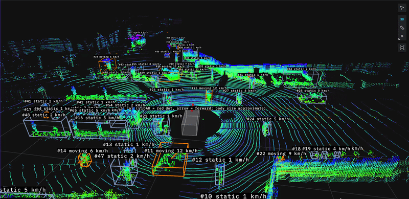
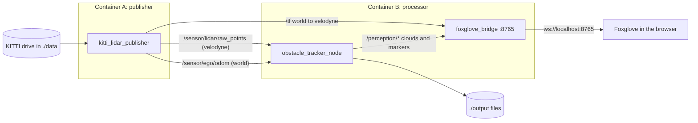
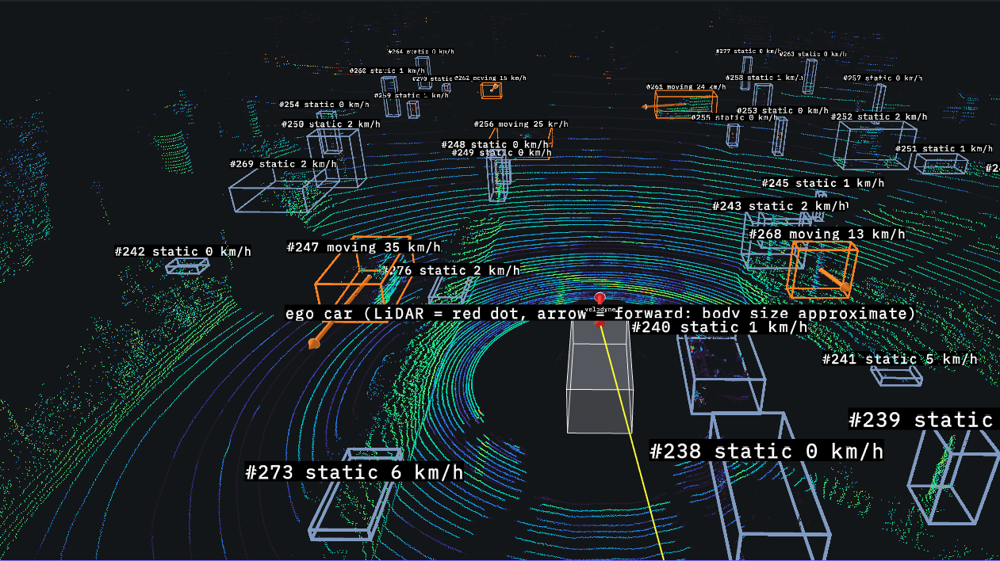

# LiDAR Obstacle Tracking

By Rene Bitton



BGRacing Autonomous home assignment. A two-container ROS 2 Jazzy pipeline replays a KITTI raw LiDAR drive as a live sensor, detects obstacles, and tracks them in a world frame. Velocities are corrected for the car's own motion, so parked cars read about 0 m/s, and they are scored against KITTI's ground-truth tracklets. Every number below is regenerated by one command (see [How to run](#how-to-run)); the design decisions and rejected alternatives are in [docs/design.md](docs/design.md). The results are on the first drive; a [second drive](#second-drive-kitti-drive-0011), where the car comes to a stop, shows how it carries over. What does not work yet is listed in [Known gaps](#known-gaps).


- **Detect:** ROI crop, voxel downsampling, seeded RANSAC ground removal with local ground tiles, 2D DBSCAN clustering and an oriented size filter. Car+Van recall 0.908.
- **Track:** Kalman filter plus Hungarian association in the `world` frame, with the ego pose from the GPS/IMU. Parked cars read a median 0.38 m/s; the lead van and the cyclist read within 0.22 and 0.24 m/s of the ground truth.
- **Prove it:** one command scores the tracks and runs the ablation. Without ego compensation the parked-car velocity error is 8.19 times larger.

## Architecture

Two containers on compose's default bridge network exchange ROS 2 topics. Every message carries the dataset timestamp of its sweep, and nothing uses wall-clock time for velocities.



| Topic | Type | Frame | Published by | Contents |
|---|---|---|---|---|
| `/sensor/lidar/raw_points` | `PointCloud2` | `velodyne` | publisher | x, y, z, intensity of one sweep; sensor-data QoS (best effort) |
| `/sensor/ego/odom` | `Odometry` | `world` | publisher | pose of the `velodyne` frame in `world`, plus the car's twist in `velodyne` axes |
| `/tf` | `TFMessage` | | publisher | `world → velodyne`, one per sweep |
| `/perception/filtered_points` | `PointCloud2` | `velodyne` | processor | points after ROI, downsampling and ground removal |
| `/perception/bounding_boxes` | `MarkerArray` | `world` | processor | one wireframe box per confirmed track, colored by state (the label topic carries the state as text) |
| `/perception/obstacle_vectors` | `MarkerArray` | `world` | processor | one arrow per moving track, length = speed × 0.5 s |
| `/perception/track_labels` | `MarkerArray` | `world` | processor | `#ID state N km/h` per confirmed track |
| `/perception/ego_vehicle` | `MarkerArray` | `velodyne` | processor | display only: the ego car as a translucent box, the LiDAR origin and a forward arrow (size is approximate) |

Two frames: `velodyne` (the sensor frame; clouds are published in it) and `world` (ENU axes, origin at the first GPS/IMU position; boxes, arrows and labels are published in it). The same ROS-free code (`core/` and `processor/`) runs live and in the offline runner, which is where all reported numbers come from.

## Dataset

KITTI raw drive `2011_09_26_drive_0005`, "synced + rectified": a city drive with moving and parked cars. The pipeline uses the Velodyne HDL-64 sweeps, the OXTS GPS/IMU poses, the IMU → Velodyne calibration and the tracklet ground truth.


| Property | Value |
|---|---|
| Sweeps | 154 over 15.80 s |
| Sensor rate | 9.68 Hz mean (period 102.7–103.7 ms), not 10 Hz |
| Points per sweep | mean 121,732; min 98,532; max 124,122 (float32 x, y, z, reflectance) |
| Range | 83 % of points within 20 m of the sensor, 96 % within 40 m, none beyond 82 m |
| Ego speed (OXTS) | 3.1–6.5 m/s, mean 4.5 m/s |
| Points kept by each stage | 92.0 % after the ROI, 26.2 % after voxel downsampling, 12.5 % after ground removal, 3.8 % in the kept clusters (means 112,002 / 31,938 / 15,232 / 4,565 points per sweep) |
| Ground truth | 15 tracklets (9 Car, 3 Van, 2 Pedestrian, 1 Cyclist), 717 boxes, all in front of the car |

The numbers come from [`docs/samples/dataset_stats.json`](docs/samples/dataset_stats.json); two runs give byte-identical files. Regenerate them (no publisher needed) into `output/`:

```bash
docker compose run --rm --no-deps processor python3 /app/scripts/dataset_stats.py
```

**Time and poses.** Every message carries the sweep's stamp from `velodyne_points/timestamps.txt`, read as UTC. Poses come from OXTS via a Mercator projection, the same convention as pykitti, with `T_world_velo = T_world_imu · inverse(T_velo_imu)`.

### Second drive statistics

Optional, drive `2011_09_26_drive_0011`. The same pipeline, unchanged, on a longer drive in which the car brakes to a stop. Statistics from [`docs/samples/2011_09_26_drive_0011/dataset_stats.json`](docs/samples/2011_09_26_drive_0011/dataset_stats.json):

| Property | Value |
|---|---|
| Sweeps | 233 over 24.03 s |
| Sensor rate | 9.66 Hz mean (period 103.3–103.8 ms) |
| Points per sweep | mean 112,550; min 105,347; max 121,644 |
| Range | 73 % of points within 20 m of the sensor, 93 % within 40 m, none beyond 82 m |
| Ego speed (OXTS) | 0.0–11.9 m/s, mean 4.8 m/s; below 0.1 m/s in the last 67 sweeps (about 7 s) |
| Ground truth | 20 tracklets (15 Car, 1 Van, 1 Truck, 1 Misc, 1 Pedestrian, 1 Cyclist), 1,504 boxes |

## Pipeline

Each sweep goes through the same ROS-free code in the live node and in the offline runner. All parameters are in [`config/tracker.yaml`](config/tracker.yaml), read by both.

### Detection (`processor/perception.py`, `velodyne` frame)

1. **Region of interest:** x ∈ [−40, 40] m, y ∈ [−20, 20] m, z ∈ [−3, 2] m, minus the box around the ego car (|x| < 2.5 m, |y| < 1.5 m).
2. **Voxel downsampling:** one point per 0.15 m voxel, placed at the voxel's grid center, so the result does not depend on point order.
3. **Ground removal:** RANSAC plane fit (100 iterations, 0.2 m inlier distance), seeded per frame from a fixed seed and the sweep's stamp. The best plane is removed only if it is near-horizontal (|normal z| > 0.9); otherwise the frame is marked `no_plane` and nothing is removed. The ground is then refined per 10 × 10 m tile: a plane is fitted to each tile's voxels within 0.6 m of the global plane (trimmed twice to 0.15 m) and voxels within 0.2 m of it are removed too. One plane can't follow 80 m of road, and the band of ground it leaves joined cars to walls and bushes in the clustering. A tile with fewer than 30 candidates, or a plane that is too steep, keeps the global result.
4. **Clustering:** DBSCAN on (x, y), eps 0.6 m, at least 8 points. Two dimensions are faster and avoid splitting an object vertically.
5. **Size filter:** a cluster stays if it has at least 10 voxels, an oriented length ≤ 7 m and width ≤ 3 m (the minimum-area rectangle of its footprint), and a height between 0.3 and 3 m. The orientation matters: the car turns about 75° during the first drive, so an axis-aligned width limit would reject 37–46 % of the vans in the ground truth even with perfect segmentation.
6. **Detection:** the axis-aligned box of each kept cluster (center, extents dx/dy/dz, voxel count). Boxes are not rotated.

### Tracking (`processor/tracking.py`, `world` frame)

1. **World frame:** each detection center is moved into `world` with the ego pose that carries the same dataset timestamp, so parked objects keep the same position while the car drives.
2. **Prediction:** a constant-velocity Kalman filter per track, state (x, y, vx, vy). Δt comes from the dataset timestamps, never from wall time. Process noise 1.0 (m/s²)², measurement noise 0.5 m. Both were fixed before any tracking code ran and have not been tuned.
3. **Association:** Hungarian assignment on the distance between predicted and detected centers, gated at 2.0 m.
4. **Lifecycle:** a track is confirmed after 3 hits and deleted after 5 consecutive misses. A missing sweep counts as a miss, so a processing stall never resets anything. Only the dataset loop (timestamps jump back) resets the tracks, and IDs restart at 1 for each pass.
5. **Motion state:** a track is `moving` only if it is *confidently* faster than 0.7 m/s: speed − 2σ > 0.7 m/s, where σ is the filter's own speed uncertainty. With the plain rule (speed > 0.7 m/s), 197 of 417 tracks read as moving on the first drive: mostly short-lived poles, bushes and wall pieces whose box center slides as the car drives past. The cost: σ settles at about 0.31 m/s, so the effective threshold is about 1.3 m/s and a walking pedestrian is labelled `static` (its label still shows its speed).

Velocities come from the filter state, not from differences of box centers.

### Why these values

| Parameter | Value | Why |
|---|---|---|
| `voxel_size` | 0.15 m | cuts about 120k points to about 32k; keeps the whole frame under the 100 ms sensor period |
| `ransac_iters`, `ransac_dist` | 100, 0.2 m | enough three-point samples to find the road plane; seeded, so runs repeat |
| `dbscan_eps`, `dbscan_min_samples` | 0.6 m, 8 | chosen before any detection result; a sweep was tried afterwards and the defaults were kept |
| Size limits | 7 × 3 × (0.3–3) m | a van fits; walls and buildings don't (nor does a bus or a long truck, see [Known gaps](#known-gaps)) |
| `gate_m` | 2.0 m | the same gate scores detections against the ground truth |
| `confirm_hits`, `max_misses` | 3, 5 | a track is drawn after 3 sightings and survives 5 missed sweeps |
| `q_accel`, `r_pos` | 1.0, 0.5 m | fixed before any tracking code ran; not tuned |
| `moving_speed`, `moving_sigma` | 0.7 m/s, 2 | the confident motion state above |

Every parameter was set on the first drive.

## Results

All numbers in this section come from the offline runner over all 154 sweeps of the first drive. The committed copies are in [`docs/samples/`](docs/samples/); two runs give byte-identical files (verified on arm64 and on GitHub's x86_64 runner).

### Detection

Scored against the KITTI tracklets in the front half of the region of interest (where ground truth exists), one-to-one Hungarian matching on 2D box centers with a 2.0 m gate. Source: [`docs/samples/detection_recall.json`](docs/samples/detection_recall.json).

| Class | Matched / ground-truth boxes | Recall | Tracklets |
|---|---|---|---|
| **Car + Van (the gated number)** | **472 / 520** | **0.908** | 12 |
| Car | 234 / 248 | 0.944 | 9 |
| Van | 238 / 272 | 0.875 | 3 |
| Pedestrian (small sample) | 6 / 22 | 0.273 | 2 |
| Cyclist (small sample) | 153 / 154 | 0.994 | 1 |

- The mean distance between matched centers is 0.54 m (90th percentile 1.39 m). Boxes are axis-aligned, so a car seen from one side can have its center offset from the true center.
- The weakest tracklet is parked van #3, matched in 76 of 107 frames (0.710): its misses are clusters merged into something larger than a van, and I have not diagnosed with what. Pedestrians are mostly missed; also undiagnosed.
- Detections that match no ground-truth box (32.0 per sweep) are not a false-positive rate: the tracklets label only a few object types.
- Time per sweep for the detection stages on an Apple M5 Pro in Docker (arm64): 95th percentile about 50 ms, against a 75 ms bar and the 100 ms live period. Timing varies by machine and is not part of the samples.

### Tracking

Tracks are matched to the KITTI tracklets per sweep in the front half of the region of interest (Hungarian, 2D centers, 2.0 m gate) and scored per tracklet. A track's first 5 frames after confirmation are left out. Ground-truth speed is the difference of the tracklet's world positions over ±5 sweeps (1 s); over ±1 sweep, label jitter alone makes parked cars read 0.2–0.45 m/s. Source: [`docs/samples/tracking_speeds.json`](docs/samples/tracking_speeds.json) and, without ego compensation, [`docs/samples/tracking_speeds_no_ego.json`](docs/samples/tracking_speeds_no_ego.json).

**Parked objects** (the 10 tracklets that move less than 0.5 m/s in the ground truth), median filtered speed in m/s:

| Tracklet | Class | Frames scored | With ego compensation | Labelled moving | Without (ablation) |
|---|---|---|---|---|---|
| #3 | Van | 88 | 0.25 | 0 % | 4.68 |
| #5 | Car | 34 | 0.50 | 9 % | 5.41 |
| #6 | Car | 28 | 0.09 | 0 % | 5.70 |
| #7 | Car | 33 | 0.22 | 0 % | 6.50 |
| #8 | Van | 22 | 0.57 | 0 % | 4.98 |
| #9 | Car | 34 | 0.11 | 0 % | 6.41 |
| #10 | Car | 28 | 0.57 | 7 % | 5.81 |
| #11 | Car | 16 | 0.54 | 0 % | 5.16 |
| #13 | Car | 9 | 0.66 | 0 % | 5.41 |
| #14 | Car | 19 | 0.16 | 0 % | 6.26 |
| **Median of the medians** | | | **0.38** (bar 0.5) | | |

Every parked tracklet reads under 0.7 m/s (the bar; the worst is #13 at 0.66, scored on only 9 frames). Without ego compensation the same cars read 4.7–6.5 m/s: the car's own motion.

**Moving objects** (median |filtered speed − ground-truth speed| per sweep; both accelerate during the drive):

| Tracklet | Class | Frames scored | Ground-truth speed (median) | Error (median, 90th pct.) | Labelled moving | Without ego compensation |
|---|---|---|---|---|---|---|
| #0 | Van | 103 | 4.77 m/s | 0.22, 1.00 m/s | 100 % | 1.87 m/s |
| #1 | Cyclist (small sample) | 147 | 4.62 m/s | 0.24, 0.47 m/s | 100 % | 3.72 m/s |

The bar is 0.5 m/s per object. `./scripts/verify.sh` gates both tables and checks that they fail without ego compensation.

**The report image** (`obstacle_tracking_report.png`, at the top): the ego path in black, moving tracks as solid lines with an ID and a velocity arrow (0.5 s ahead), static tracks thin, dashed and grey. A track is drawn as moving if the tracker labelled it `moving` in at least half of its sweeps. The offline report tags every track matched to a moving ground-truth tracklet (`#30 = GT #0 Van`, `#25 = GT #1 Cyclist`, and so on). **These class names come from the ground truth, as the footnote on the image says: the processor does not classify objects.**

**Live.** The live node gives byte-for-byte the same tracks as the offline tracker fed the same sweeps: checked over 4 passes (34,718 track rows, 0 mismatched), including passes with dropped sweeps. The tracking step itself takes under 2 ms.

### Evaluation

One command, with no publisher and no Foxglove, runs the offline pipeline twice (with and without ego compensation), scores both runs against the KITTI tracklets and writes `output/evaluation.md` (about 16 s). The committed copy is [`docs/samples/evaluation.md`](docs/samples/evaluation.md); the tables below are quoted from it. It has six parts, each with a short "how to read this" note.

**The main result: ego compensation.** This is the only number with a pass/fail bar, fixed before the first run. Static-object velocity RMSE (matched parked-car frames after the warm-up) is **0.653 m/s** with ego compensation and **5.348 m/s** without it: a ratio of **8.19**, against a bar of at least 3. Without the ego pose, 100 % of parked-car frames are labelled `moving` (277 of 277) instead of 1.6 % (5 of 311).

**Accuracy on the labelled objects** (no bar by design): overall recall 0.904 and center error 0.568 m; Cyclist 0.987, Car 0.972, Van 0.853, Pedestrian 0.182 (small samples for the last two).

Car+Van recall is 0.910 (473 of 520 box-frames; the detection-only recall above is 0.908). Parked objects are labelled `static` in 0.984 of their frames (306 of 311); moving objects are labelled `moving` in 0.981 (253 of 258). There are 6 ID switches, all on parked cars.

**Most tracks have no label, and that is expected.** Of the 238 tracks with a frame in the evaluation region, 18 match a KITTI tracklet and 220 never do. Many are probably poles, signs, trunks, bushes or walls that the tracklets do not contain. Physics still checks them: once ego motion is removed, a fixed object must stay still. The 127 scored unlabelled tracks have a median speed of 0.358 m/s (parked cars: 0.413) and read 5.464 m/s without ego compensation. This shows consistency, not correctness, and the processor classifies nothing.

**False-moving rate.** Of the in-region track-frames that match no label, 0.086 (338 of 3,925) are labelled `moving` after the warm-up (0.978 without ego compensation). It is the baseline that any fix for tracks wrongly labelled `moving` has to beat.

### Second drive (KITTI drive 0011)



To see how the pipeline holds up beyond the drive it was built on, I ran it unchanged on a second KITTI drive, one in which the car brakes to a stop, with no further tuning (every parameter was set on the first drive; this drive also served to test changes I then rejected, so it is a second example, not an untouched test set). Detection and ego compensation carried over: Car+Van detection recall is 0.903 (324 / 359 box-frames) and removing ego compensation makes the static-object velocity error 15.52 times larger, both above their bars. The speed-accuracy tests, the parked and moving objects' speeds, did not meet their bars, so they need further tuning for optimal results on this drive (see [Known gaps](#known-gaps)). The full evaluation is in [`docs/samples/2011_09_26_drive_0011/`](docs/samples/2011_09_26_drive_0011/evaluation.md); the commands to reproduce it are under [Commands](#commands).

## How to run

### Prerequisites

- Docker with Compose v2 (Docker Desktop on macOS or Windows, Docker Engine on Linux). The two images take about 1.8 GB and 1.3 GB of disk; the drive is a 646 MB download that unpacks to about 290 MB in `./data`.
- `curl` and `unzip` on the host (the download script checks and tells you how to install them).
- Port 8765 free on the machine that runs Docker.
- For the live view: Chrome, Edge or Firefox and a free Foxglove account (or the Foxglove desktop app, which needs no account).

No Python, ROS or pip packages are needed on the host. The images are built from `ros:jazzy-ros-base` (Ubuntu 24.04, Python 3.12, pinned by digest) with the dependencies from apt.

### Commands

```bash
./scripts/download_kitti.sh                     # fetch the drive into ./data
docker compose up --build                       # run the pipeline (publisher + processor)
```

Stop it with `Ctrl+C` or `docker compose down`: the processor then writes its final files, including the report image.

```bash
docker compose run --rm --no-deps processor python3 /app/scripts/dataset_stats.py   # dataset statistics → output/
docker compose run --rm --no-deps processor python3 /app/scripts/run_offline.py      # detections, tracks, recall → output/offline/
docker compose run --rm --no-deps processor python3 /app/scripts/evaluate.py         # evaluation.md, both runs → output/
./scripts/verify.sh                                                                  # build, smoke import, all tests
```

Optionally, the same pipeline on the second drive:

```bash
./scripts/download_kitti.sh 2011_09_26_drive_0011
docker compose run --rm --no-deps processor python3 /app/scripts/dataset_stats.py --drive 2011_09_26_drive_0011
docker compose run --rm --no-deps processor python3 /app/scripts/evaluate.py --set drive=2011_09_26_drive_0011
KITTI_DRIVE=2011_09_26_drive_0011 docker compose up --build   # the live view; writes to output/, over a first-drive run
```

The offline commands for it write into `output/2011_09_26_drive_0011/`.

The offline commands use `--no-deps`, so they don't start the publisher. `run_offline.py --set ego_compensation=false` runs the ablation by itself (results in `output/offline/no_ego/`).

The download script accepts only the two drives in this README. It checks every zip against a pinned SHA-256 before unzipping it. The hashes were measured from one download in Nov 2026 (KITTI publishes none), so a match shows you have the same files the results came from.

### Expected outputs

| File in `output/` | Written by | What it is |
|---|---|---|
| `tracks.csv` | `docker compose up` (periodically and on stop) | every confirmed track state per frame, world frame: `pass, frame, stamp_ns, track_id, x, y, vx, vy, speed, state, l, w, h` |
| `detections.csv`, `frames.csv` | `docker compose up` | per-frame detection rows and stage point counts |
| `metrics.json` | `docker compose up` | frames processed and dropped, timing, track counts, seed and parameters (timing varies between runs) |
| `obstacle_tracking_report.png` | `docker compose up`, on stop only | top-down map of the tracks |
| `dataset_stats.json`, `dataset_stats.png` | `dataset_stats.py` | the dataset statistics above |
| `evaluation.md` | `evaluate.py` | the six-part evaluation; identical to [`docs/samples/evaluation.md`](docs/samples/evaluation.md) |
| `offline/` | `run_offline.py` | detections, tracks, `detection_recall.json`, `tracking_speeds.json` and the report image of the offline run |

For a drive other than the first, the offline commands write the same files into `output/<drive>/` instead. To check your run against the committed results:

```bash
diff output/evaluation.md docs/samples/evaluation.md && echo "evaluation.md matches the sample"
```

The files in `output/` are readable and deletable by the host user. `./scripts/verify.sh` does this comparison for `evaluation.md` and the three JSON samples; it needs the first drive in `./data`, and the real-data tests fail (they never skip) without it. A GitHub Actions workflow ([`.github/workflows/verify.yml`](.github/workflows/verify.yml)) runs the whole reviewer flow on an `ubuntu-24.04` (x86_64) runner: download, build, `verify.sh`, `evaluate.py` and the diff above, a live run and stop, and deleting `output/` as a normal user.

### Live view in Foxglove

1. Run `docker compose up --build` and wait until the processor log shows `foxglove_bridge` listening on port 8765.
2. Open <https://app.foxglove.dev> in Chrome, Edge or Firefox and sign in (a free account is required).
3. Choose Open connection → Foxglove WebSocket → `ws://localhost:8765`.
4. Import the layout: Layout menu → Import from file → [`viz/foxglove_layout.json`](viz/foxglove_layout.json). It shows the raw and filtered clouds, the boxes, arrows and labels, the ego car and a plot of the ego speed, with the display frame set to `world`. The ego car then drives through a still scene, and the parked cars stay put.

The bridge listens on `127.0.0.1` only, because `foxglove_bridge` has no authentication. Open Foxglove on the machine that runs Docker.

### Troubleshooting

| Symptom | Cause and fix |
|---|---|
| The download fails | KITTI may need a login or the mirror may be down. The script prints the three files to download by hand from the KITTI raw-data page and where to put them. |
| The download script says `Unknown drive` | Only `2011_09_26_drive_0005` (the default) and `2011_09_26_drive_0011` are accepted. |
| `docker compose up` stops with an error naming the download script | `./data` is empty or incomplete for the drive you chose. Run `./scripts/download_kitti.sh` with that drive. |
| The processor logs that the first 10 sweeps are not in its drive | The two services run different drives. Set `KITTI_DRIVE` once for the whole `docker compose up`. |
| Foxglove can't connect | Use Chrome, Edge or Firefox. Safari, and Brave with Shields on, can block a secure page from opening `ws://localhost`. Check `docker compose ps` shows `127.0.0.1:8765->8765`. Foxglove must run on the same machine as Docker. The desktop app needs no account. |
| The 3D panel is empty | Set the display frame to `world` (or `velodyne` for the raw clouds), and check the topics are switched on in the panel's sidebar. Re-import the layout if you changed it. |
| `verify.sh` fails on the byte comparison of a sample | Compare with `diff`. The samples are verified on arm64 and on GitHub's x86_64 runner; a different CPU can in principle give a last-digit difference that is not a code defect. Please tell me what you see. |
| Frames are dropped in the live run | About 2 % of sweeps can be lost on the bridge network; the count is in `metrics.json`. The reported numbers come from the offline runner, which never drops. |

## Known gaps

These are the five that matter most. Each is measured or observed, and none is fixed.

1. **Clutter tracks are labelled `moving`.** Poles, bushes and wall pieces whose box center slides as the car passes still read as moving: 0.086 of the unmatched in-region track-frames on the first drive and 0.081 on the second (320 of 3,959). The confident-motion rule already cut it (197 of 417 tracks read as moving without it). Likely fixes (measurement noise that grows with range, a steadier reference point on each box, hysteresis on the state) are untried.
2. **Buses and long trucks are not handled.** The size filter drops any cluster longer than 7 m or wider than 3 m, so a bus never becomes one obstacle. Neither drive has a bus. The one truck in the second drive is matched in only 39 of 72 box-frames (0.542) and its speed is 2.08 m/s off; I have not checked that the size filter is the cause.
3. **Speed accuracy did not carry over to the second drive.** On the first drive the moving objects (a van and a cyclist at about 4.7 m/s) are within 0.5 m/s. On the second, six of seven moving objects are 0.96–2.08 m/s off at 4–10 m/s, and two parked tracklets are never scored. Axis-aligned boxes, whose center shifts as the view changes, are a suspect; this is not diagnosed.
4. **No object classes, and slow movers read `static`.** Tracks carry no class, and a walking pedestrian is labelled `static` by design (the motion rule needs a speed above about 1.3 m/s). Pedestrians are also mostly missed on the first drive (6 of 22 boxes, recall 0.273).
5. **Thin evidence.** Ground truth exists only in front of the car, so every score covers the front half. There are two drives, and every parameter was set on the first. Live, about 2 % of sweeps are lost, so reported numbers come from the offline runner.

Smaller caveats: boxes are axis-aligned in the sensor frame, so `l, w, h` in `tracks.csv` change as the car turns; the ego car in Foxglove is for orientation only; byte-identical results are verified on arm64 and on GitHub's x86_64 runner, not on every CPU, and the apt packages in the images are not pinned; Foxglove's web app needs a free account.

## Credits

Dataset: [KITTI Vision Benchmark Suite](https://www.cvlibs.net/datasets/kitti/) (Geiger, Lenz, Stiller, Urtasun), licensed CC BY-NC-SA 3.0. The statistics, plots, screenshots and evaluation files in `docs/samples/` are derived from it and are shared under the same terms, for non-commercial use with this attribution. The KITTI data itself is not in this repository. The code is under the MIT licence ([LICENSE](LICENSE)).
